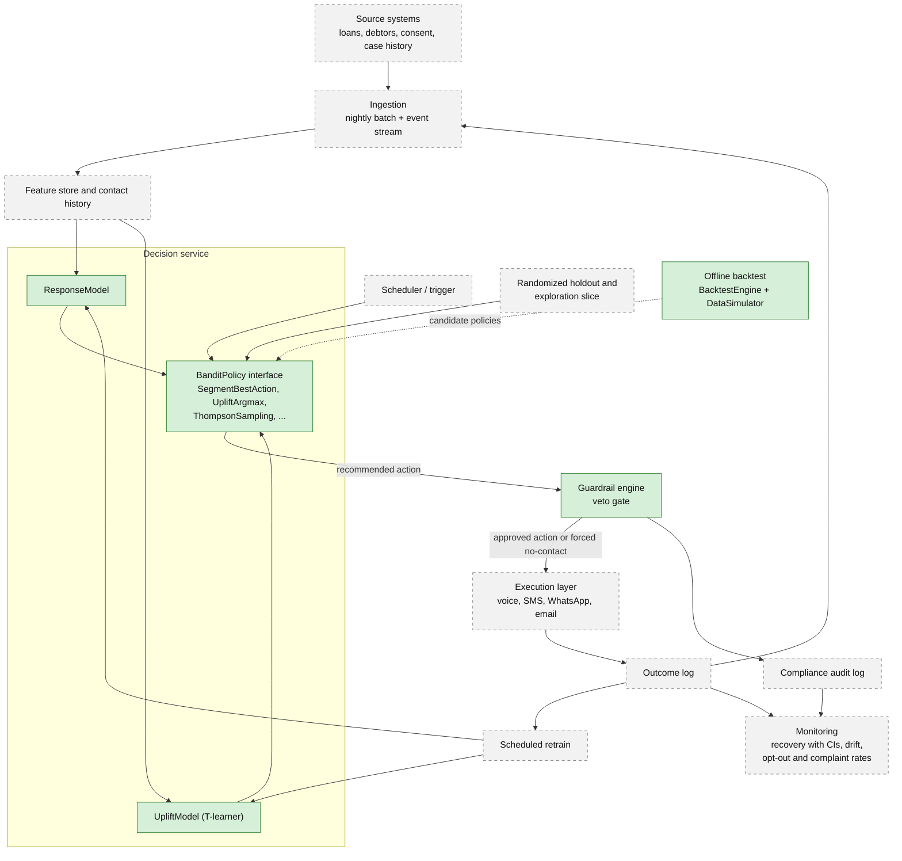
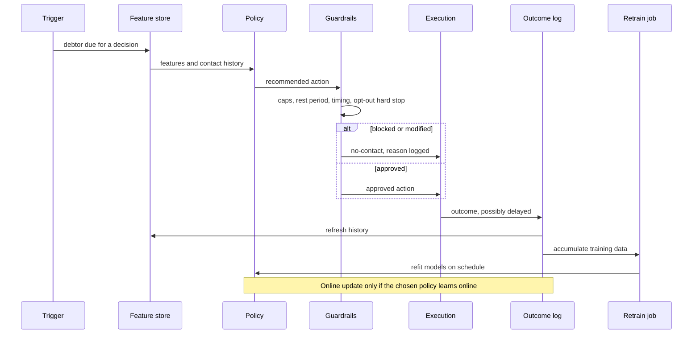

# From Notebook to Production: Contact-Strategy System Architecture

## 1. Purpose and scope

This document sketches how the approach in [notebooks/uplift_contact_strategy.ipynb](notebooks/uplift_contact_strategy.ipynb) could be taken toward a production contact-strategy system: who to contact, through which channel, at what time, under compliance limits. It is a design, not a deployed system.

**Built in this repo** (all in [src/](src/)): a synthetic data-generating process and simulator, a response model, a T-learner uplift model, a hierarchical Thompson Sampling bandit and other policies, two simple baselines, a guardrail layer, and a multi-seed backtest.

**Design only**: ingestion, feature store, serving API, rules-engine service, execution layer, monitoring, and retraining jobs. Nothing in this document has been implemented or load-tested.

**Non-goals**
- No real data. Every result comes from a synthetic process written by the same author as the models.
- No build of the execution layer (voice, SMS, WhatsApp, email). It is described only as an interface.
- Guardrails are illustrative examples of the class of constraint a deployment would enforce, not legal advice or any jurisdiction's actual rules.
- Cloud-agnostic: components are described by responsibility, not by product.

**The backtest result shapes this design.** Over 30 seeds at a contact budget of 0.5, a model-free per-segment lookup (2,676 ± 103 recovered) beat the static uplift argmax (2,362 ± 82) and the Thompson bandit (2,271 ± 95). The bandit did not beat either simple baseline on this data-generating process, where segment is nearly a sufficient statistic. The architecture therefore does not assume the bandit is the default policy. It makes the policy swappable and puts a gate in front of promoting anything complex.

## 2. High-level architecture

Legend: solid green nodes are implemented in [src/](src/) (as classes, not services). Dashed grey nodes are design only.

The guardrail engine sits between the decision service and execution. It sees every recommendation and can replace it with a no-contact action, whatever the policy says. Compliance is a veto gate on the data path, not a property of any model.

## 3. Component-to-code map

| Component | Code | Notes |
|---|---|---|
| Synthetic data and simulator | `DebtorDGP`, `DataSimulator` in [src/dgp.py](src/dgp.py) | Stands in for ingestion, the feature store, and the real world |
| Response model | `ResponseModel` in [src/modeling.py](src/modeling.py) | P(pay given features). Cannot choose between actions |
| Uplift model | `UpliftModel` (wrapping `TLearner`) in [src/modeling.py](src/modeling.py) | CATE per channel and timing. Held-out correlation with truth is 0.345 |
| Policy interface | `BanditPolicy` in [src/bandit.py](src/bandit.py) | See section 4 |
| Policies | `ThompsonSamplingPolicy`, `EpsilonGreedyPolicy`, `ResponseOnlyPolicy`, `RandomPolicy` in [src/bandit.py](src/bandit.py); `UpliftArgmaxPolicy`, `SegmentBestActionPolicy` in [src/baselines.py](src/baselines.py) | |
| Guardrails | `Guardrails.apply` in [src/guardrails.py](src/guardrails.py) | Returns a possibly overridden action and a block reason |
| Backtest and CIs | `BacktestEngine`, `mean_ci`, `compare_policies` in [src/backtest.py](src/backtest.py) | Per-decision `guardrail_block_reason` is recorded in `policy_decisions` |
| Ingestion, feature store, serving API | design only | |
| Rules-engine service, audit log | design only | `Guardrails` is the logic, not a service |
| Execution layer, outcome log | design only | |
| Scheduled retrain, monitoring, holdout assignment | design only | |

## 4. Policy-agnostic decision service

The decision service depends on one interface, `BanditPolicy` in [src/bandit.py](src/bandit.py):

- `select_arm(features, state, week) -> Action`: the decision for one debtor at one time step.
- `update(arm, outcome)`: learn from an observed outcome. A no-op for static policies.
- `fit(X, T, y)`: warm-start or fit from historical data. (`SegmentBestActionPolicy.fit` takes the historical log dataframe as its first argument, `UpliftArgmaxPolicy.fit` is a no-op because its model is fitted externally, and `ThompsonSamplingPolicy.fit` also accepts an optional `features_df` used for its model-based warm start.)
- `reset()`: clear per-run state.
- `prepare_cohort(cohort_df)`: optional hook, a no-op by default. Budgeted policies use it to rank the whole cohort before any per-debtor decision.
- `get_summary()`: inspectable policy state for logging.

`Action` and `DebtorState` come from [src/dgp.py](src/dgp.py). `BacktestEngine` already drives every policy through this interface identically: select, apply guardrails, observe outcome, update.

Why this follows from the backtest: no policy dominated. The segment lookup won on recovery, the static uplift argmax won on recovery per contact, and all targeted policies cut contacts and trust cost versus random. Hard-wiring the bandit would commit the system to the one component that did not outperform simpler policies on this synthetic data. With a common interface, `SegmentBestActionPolicy`, `UpliftArgmaxPolicy`, and `ThompsonSamplingPolicy` are interchangeable.

One gap to close in a real service: `prepare_cohort` assumes a batch cohort known up front, which is how contact budgets are enforced in the backtest. A serving implementation would compute that ranking in a scheduled job and look the result up per request.

## 5. Staged rollout

1. **Champion.** Start with `SegmentBestActionPolicy`: a lookup table fitted from randomized data, easy to audit, and the highest-recovery policy in the backtest (with more contacts and a higher opt-out rate than the uplift-based policies).
2. **Shadow.** Run `UpliftArgmaxPolicy` and `ThompsonSamplingPolicy` on live traffic without executing their output. Log what each would have done, and compare with what the champion did.
3. **Challenger.** Give a challenger a small randomized share of traffic at the same eligible-debtor budget and the same guardrails as the champion.
4. **Promote** only if the challenger beats the champion in the live randomized comparison, with confidence intervals reported as in the backtest.

Illustrative promotion criteria (thresholds are placeholders to be set per deployment):
- Lower bound of the 95% CI on the recovery difference is above zero over a pre-agreed window.
- Opt-out and complaint rates are no worse than the champion's beyond a pre-set margin.
- Guardrail block rates and reasons look similar to the champion's.

Illustrative rollback triggers:
- Any guardrail violation reaches execution (zero tolerance).
- A trust-cost metric breaches its margin.
- Realized outcome rates diverge from model predictions for a segment beyond a set tolerance.

## 6. One decision cycle

A decision is synchronous: feature lookup, policy, guardrail check, execution. Outcomes arrive asynchronously and may take days.

Two update cadences, kept separate:
- **Scheduled retrain** of the response and uplift models (and refit of the segment table) on accumulated, randomized data. This applies to every policy.
- **Online update** per outcome (`update(arm, outcome)`), only if the deployed policy learns online, as `ThompsonSamplingPolicy` does. The backtest gives no evidence this layer pays for itself, so it belongs to challenger policies, not the default.

## 7. Production evaluation

- **Permanent randomized holdout.** A small share of debtors always receives a reference policy (for example random within guardrails, or the champion). This is the only way to measure the live policy's incremental value without relying on modelling assumptions.
- **Exploration slack.** The uplift model is cleanly identified in the notebook only because the historical log was randomized. If a production policy becomes fully deterministic, later retrains lose that. Keep a randomized slice, or enough built-in randomness, to keep effects identifiable.
- **Off-policy evaluation.** Before exposing a candidate, estimate its value from logged data with inverse-propensity weighting or a doubly robust estimator. This needs logged action propensities, which are known for a randomized slice and must be recorded or approximated for any stochastic policy. It is not implemented in this repo.
- **Intervals, not point estimates.** Report confidence intervals and paired differences, as the backtest does with `mean_ci` and `compare_policies`.
- **Trust cost as a first-class metric.** Track opt-out and complaint rates by segment and channel next to recovery. In the backtest, policies with statistically similar recovery differ widely in opt-outs (18.8% for Random versus 10.9% for the Thompson bandit).

## 8. Risks and failure modes

| Risk | Mitigation |
|---|---|
| Delayed or censored outcomes: the simulator resolves each week, real payments lag | Fixed attribution windows, treat unresolved cases as censored, delay or batch online updates |
| Feedback loops and confounding once the production policy generates the training data | Keep the randomized slice and holdout, and log propensities |
| Guardrail misconfiguration, such as a wrong cap or a missing region rule | Configuration under review, tests on rule changes, audit log, zero-tolerance rollback trigger |
| Segment drift: segment definitions or effects change over time | Monitor per-segment calibration, refit the segment table and models on schedule |
| Weak uplift estimates: held-out CATE correlation is 0.345 | Do not trust per-debtor ranking by default, compare against the segment champion, report intervals |
| Exploration versus trust cost: randomization contacts people who should not be | Bound exploration by guardrails, size the slice small, watch opt-out and complaint rates |

## 9. Design decisions carried over from the notebook

| Notebook decision or finding | Architectural consequence |
|---|---|
| Response model and uplift model answer different questions | Both are available to the decision service. The response model alone never picks actions (the Response-Only policy had the lowest recovery) |
| Hierarchical action space: contact or not, then channel and timing. A flat 13-way draw biased the bandit toward contact (about 92% of the time even with equally good arms, roughly 12 of 13 arms being contact arms) | Any sampling policy in the service keeps the two-stage structure |
| Guardrails are a separate layer after the policy | Guardrail engine is a veto gate between decision service and execution, with its own audit log |
| Uplift is identified by a randomized historical log | Production keeps a randomized slice and holdout so retrains stay identifiable |
| Equal eligible-debtor budget for fair comparison | Live comparisons use the same eligible budget and guardrails. Capacity limits bind in the execution layer |
| Results are mean and 95% CI over 30 seeds | Live evaluation reports intervals and paired differences |
| Opt-out and complaint tracked as backtest metrics | Trust cost is a monitored metric and a rollback trigger |
| The bandit does not beat the segment lookup or static uplift argmax | Online learning is a challenger, not the default. Champion is the simple lookup |
| Weak CATE recovery (0.345) | Promotion requires live evidence, not model scores |

## 10. Illustrative stack

Non-binding, for concreteness only: batch ETL into a warehouse for training data; an event bus so opt-outs reach the guardrails quickly; a relational or key-value store for low-latency feature and contact-history reads; a containerized API serving the policy behind the section 4 interface; a rules service with per-region configuration and an append-only audit store; dashboards over the warehouse for evaluation and trust-cost monitoring.

Evidence and limits: see the [README](README.md) (Key findings, Limitations).
