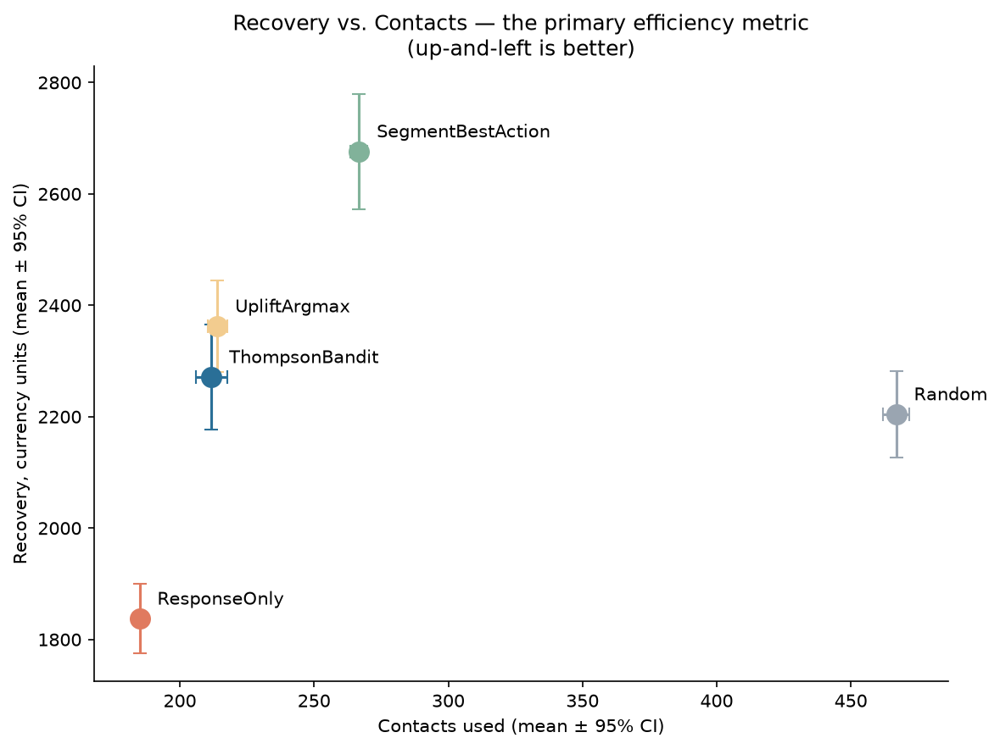

# Uplift Modeling for Debt-Collection Contact Strategy

A synthetic simulation and evaluation harness for debt-collection contact strategy: deciding who to contact, through which channel, at what time, under legal-style guardrails. The data-generating process has known ground-truth treatment effects, so each policy can be checked against the truth rather than only against another model. The repo compares a response model, a T-learner uplift model, a hierarchical Thompson Sampling bandit, and two simple baselines in a 30-seed backtest.

The result is mixed, and reported as such. Uplift-based targeting cuts contacts by about 55% at similar recovery to contacting indiscriminately. A model-free per-segment lookup, however, recovers more than every other budgeted policy, and the bandit does not beat either simple baseline on this data-generating process.

Full walkthrough: [notebooks/uplift_contact_strategy.ipynb](notebooks/uplift_contact_strategy.ipynb)

## Key findings

30 seeds, mean with 95% confidence interval, contact budget 0.5 (top half of the cohort eligible for contact). Recovery is in simulated currency units.

| Policy | Recovery | Contacts | Opt-out | Recovery / contact |
|---|---|---|---|---|
| Random | 2,204 ± 77 | 467 | 18.8% | 4.73 |
| Response-Only (deliberate strawman) | 1,837 ± 62 | 185 | 8.5% | 9.96 |
| Segment Best-Action (no model) | 2,676 ± 103 | 267 | 12.8% | 10.04 |
| Uplift Argmax (static) | 2,362 ± 82 | 214 | 10.1% | 11.07 |
| Thompson Bandit | 2,271 ± 95 | 212 | 10.9% | 10.80 |



How to read it:

- The three model- or segment-based targeted policies (Segment Best-Action, Uplift Argmax, Thompson Bandit) use far fewer contacts than Random (212 to 267 versus 467) and have lower opt-out rates (10.1% to 12.8% versus 18.8%). The bandit's recovery (2,271) is a statistical tie with Random (2,204; paired difference +67 ± 119).
- The Segment Best-Action lookup recovers about 18% more than the bandit, partly by using about 26% more contacts and at a higher opt-out rate. Per contact the two are roughly tied.
- A static uplift argmax on the same fitted model and budget is at least as good as the bandit (paired difference for the bandit: -91 ± 85). The online Thompson Sampling layer adds complexity without a demonstrated benefit here.
- Beating Response-Only is weak evidence: it uses one fixed action and ranks by who is likeliest to pay anyway.

These are results about this synthetic setup, not about real debtors. See Limitations.

## What's in the repo

- `src/dgp.py`: the data-generating process and `DataSimulator`. Segments, channels, timings, true heterogeneous treatment effects, opt-out and complaint dynamics, cohort simulation.
- `src/modeling.py`: `ResponseModel` (P(pay | features)), `UpliftModel` (T-learner CATE), and `ModelEvaluator` (estimated vs. true effects).
- `src/bandit.py`: policy interface, `RandomPolicy`, `ResponseOnlyPolicy`, `EpsilonGreedyPolicy`, and the hierarchical `ThompsonSamplingPolicy` (contact or not, then channel and timing).
- `src/baselines.py`: `UpliftArgmaxPolicy` and `SegmentBestActionPolicy`, the simple comparison points.
- `src/guardrails.py`: frequency caps, rest periods, quiet-hour timings, opt-out hard stop, applied after the policy's recommendation.
- `src/backtest.py`: multi-period, multi-seed `BacktestEngine`, confidence intervals, `compare_policies`.
- `tests/`: pytest suite for the DGP, modeling, policies, guardrails and backtest.
- `examples/`: runnable scripts (`bandit_demo.py`, `bandit_diagnose.py`, `bandit_verify.py`). These are exploratory scripts written alongside the bandit; their printed commentary may predate the final five-policy comparison, which lives in the notebook.
- `notebooks/uplift_contact_strategy.ipynb`: the full narrative with executed outputs.
- `assets/`: figures used in this README, regenerated by the notebook.
- [ARCHITECTURE.md](ARCHITECTURE.md): a design-only sketch of taking this approach toward production (components, staged rollout, evaluation, risks).

## Quickstart

Requires Python 3.12 and [uv](https://docs.astral.sh/uv/).

```bash
uv sync
uv run pytest -q

# Explore the notebook interactively
uv run jupyter lab notebooks/uplift_contact_strategy.ipynb

# Or re-execute it in place (also regenerates assets/recovery_vs_contacts.png)
uv run jupyter nbconvert --to notebook --execute --inplace notebooks/uplift_contact_strategy.ipynb

# Example scripts
uv run python examples/bandit_demo.py
uv run python examples/bandit_verify.py
```

## Method overview

- **DGP.** Four debtor segments (high risk, medium risk, low risk, frequent payer), four channels (voice, SMS, WhatsApp, email) and three timings. Payment probability depends on segment, channel, timing and contactability. The historical log uses a randomized contact policy, so treatment effects are identified without confounding. Backtest debtors are a separate cohort from the training debtors.
- **Response vs. uplift.** The response model predicts who will pay and cannot choose between actions. The uplift model is a T-learner (one model for contacted, one for uncontacted debtors, CATE as the difference) and estimates what contacting changes. Held-out CATE correlation with the known truth is 0.345.
- **Bandit.** Hierarchical Thompson Sampling: first a contact vs. no-contact decision, then a choice among the 12 channel and timing arms. Posteriors are conditioned on segment and warm-started from the historical log and uplift model, then updated online during the backtest.
- **Baselines.** `SegmentBestAction` picks, per segment, the empirically best action from the randomized log with no model. `UpliftArgmax` uses the same fitted uplift model and the same budget as the bandit but takes the argmax-CATE action with no sampling or online learning.
- **Guardrails.** A separate layer after the policy: weekly and total contact caps, rest period, timing restrictions, and a hard stop after opt-out.
- **Backtest.** Eight-week horizon, same held-out cohort, same guardrails and same seeds for every policy, 30 seeds, t-distribution confidence intervals and paired per-seed differences. "Equal budget" means the same cap on eligible debtors, not the same number of realized contacts, so contact counts are reported alongside recovery.

## Limitations

- **Synthetic data only.** No real debtor data was used, and results say nothing about real-world performance.
- **Same-author DGP.** The ground truth, models, bandit and baselines were written by one person. In this DGP segment is nearly a sufficient statistic, which favors simple segment rules. A DGP with within-segment heterogeneity that segments cannot capture would be the fair test of per-debtor uplift and online learning, and it has not been run.
- **Weak uplift estimation.** Held-out CATE correlation is 0.345, so conclusions concern this T-learner on this data, not uplift modeling in general.
- **Seeds vary only simulation noise.** The 30 seeds do not vary the backtest cohort or the training log, and nothing was tuned per policy.
- **Guardrails are illustrative.** They represent the class of constraint a deployment would enforce, not any jurisdiction's actual rules, and are not legal guidance.
- **Flat 5% recovery.** Recovery is a flat 5% of balance on a single terminal payment event, so it largely tracks payment rate.
- **Discrete trust cost.** Opt-out and complaint are terminal states; there is no gradual fatigue effect on willingness to pay.
- **Randomized history.** The historical log is randomized by construction. Real logs are observational and confounded, which is a harder problem not covered here.

## License

MIT. See [LICENSE](LICENSE).
